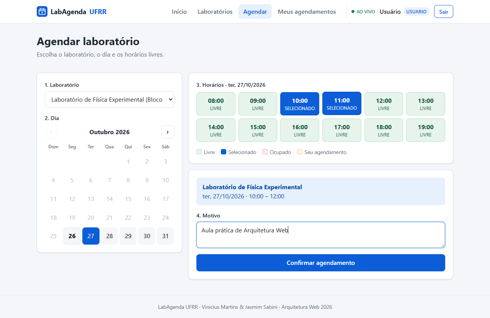
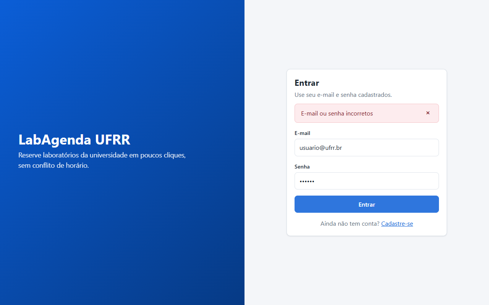
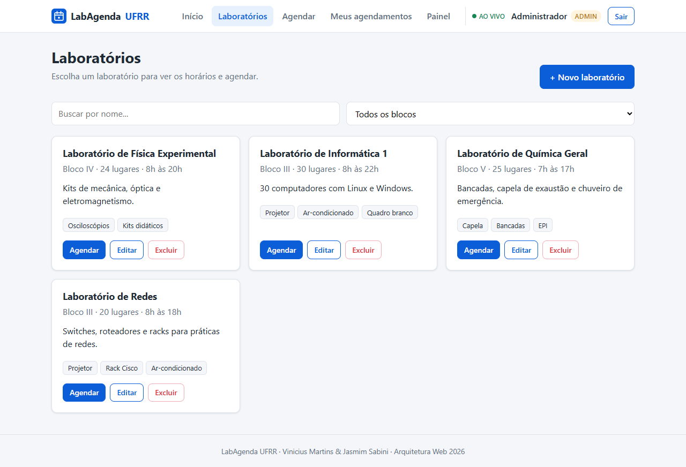
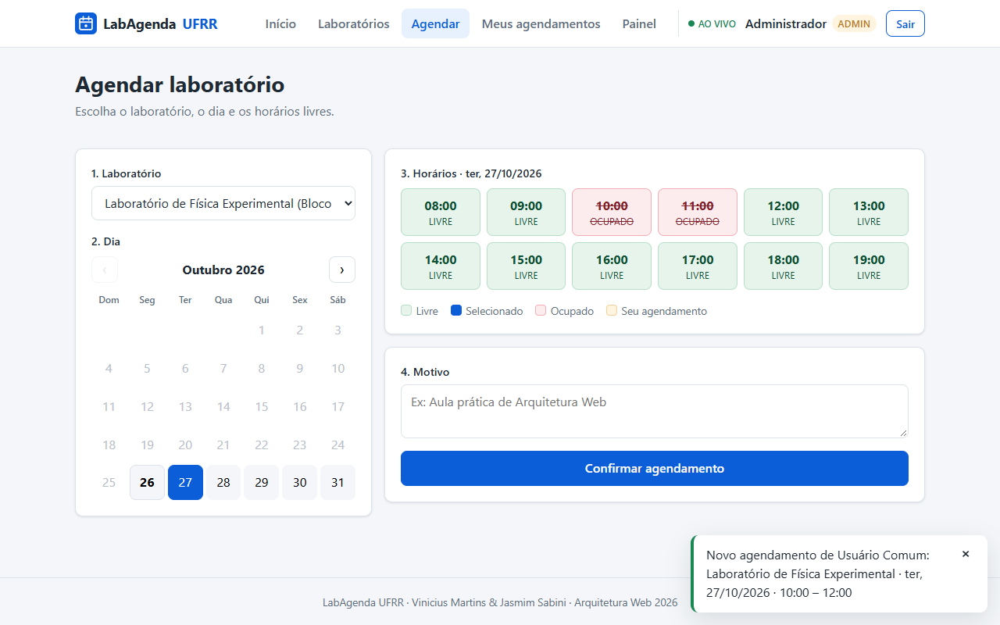
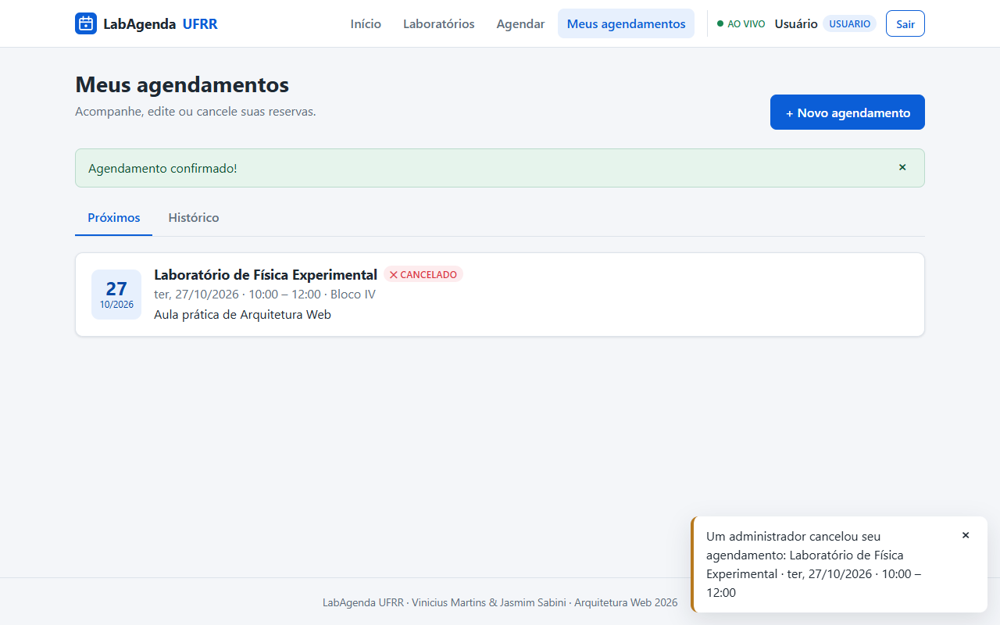
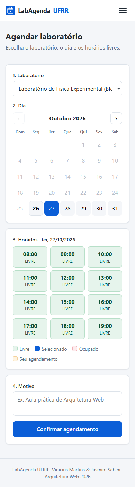
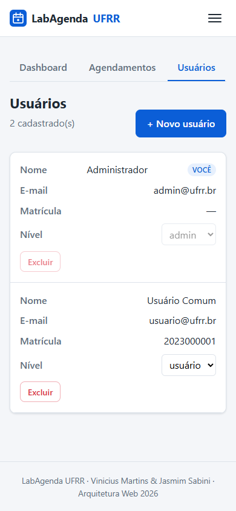

# 🗓️ LabAgenda UFRR

Sistema Full Stack de **agendamento de laboratórios da Universidade Federal de Roraima**, desenvolvido como Projeto Final da disciplina de **Arquitetura Web**.

Alunos, professores e técnicos reservam horários nos laboratórios sem conflito de horário. Administradores cadastram laboratórios, acompanham todos os agendamentos e gerenciam usuários. Tudo é atualizado **em tempo real**.

**Autores:** Vinicius Martins (2023001156) · Jasmim Sabini (2023010360)



---

## Sumário

- [Tecnologias](#-tecnologias)
- [Funcionalidades](#-funcionalidades)
- [Capturas de tela](#-capturas-de-tela)
- [Como rodar localmente](#-como-rodar-localmente)
- [Variáveis de ambiente](#-variáveis-de-ambiente)
- [Testes](#-testes)
- [Arquitetura](#-arquitetura)
- [Segurança](#-segurança)
- [API REST](#-api-rest)
- [Eventos em tempo real](#-eventos-em-tempo-real)
- [Deploy](#-deploy)
- [Requisitos do trabalho](#-requisitos-do-trabalho)

---

## 🛠 Tecnologias

| Camada    | Tecnologias                                                                       |
|-----------|-----------------------------------------------------------------------------------|
| Backend   | Node.js, Express, MongoDB + Mongoose, JWT, bcrypt (`bcryptjs`), Joi, Socket.io    |
| Frontend  | React 18 + Vite, React Router, Axios, Socket.io Client, CSS puro (Flexbox e Grid) |
| Testes    | Jest, Supertest, mongodb-memory-server                                            |
| Deploy    | Render (API), Vercel (frontend), MongoDB Atlas (banco)                            |

## ✨ Funcionalidades

| Tela                   | Usuário | Admin | Descrição                                                                 |
|------------------------|:-------:|:-----:|---------------------------------------------------------------------------|
| Login e cadastro       | ✔       | ✔     | Autenticação com mensagens de erro e validação por campo                  |
| Início                 | ✔       | ✔     | Próximos agendamentos e atalhos                                           |
| Laboratórios           | ✔       | ✔     | Busca e filtro por bloco; o admin cria, edita e exclui                    |
| Agendar                | ✔       | ✔     | Calendário + grade de horários; horários ocupados ficam bloqueados        |
| Meus agendamentos      | ✔       | ✔     | Próximos e histórico; editar e cancelar                                   |
| Meu perfil             | ✔       | ✔     | Editar dados e trocar a senha                                             |
| Painel → Dashboard     |         | ✔     | Indicadores, gráfico dos próximos 7 dias e laboratórios mais agendados    |
| Painel → Agendamentos  |         | ✔     | Todos os agendamentos com filtros; cancelar e excluir                     |
| Painel → Usuários      |         | ✔     | Criar usuários, alterar o nível de acesso e excluir                       |

**Regras de agendamento** (validadas no backend):

- o laboratório precisa existir e estar ativo;
- o horário precisa estar dentro do funcionamento do laboratório;
- não é possível agendar no passado nem com o fim antes do início;
- não pode haver sobreposição com outro agendamento confirmado no mesmo laboratório e dia;
- cancelar libera o horário na hora para outras pessoas.

**Tempo real (Socket.io):**

- a grade de horários se atualiza sozinha quando alguém reserva ou cancela no mesmo laboratório e dia;
- administradores recebem notificação de novos agendamentos e cancelamentos;
- o usuário é avisado quando um administrador altera, cancela ou exclui um agendamento dele;
- o dashboard e as listas se atualizam sem recarregar a página.

## 📸 Capturas de tela

| Erro de login | Laboratórios (admin) |
|---|---|
|  |  |

| Admin: grade atualizada em tempo real + notificação | Usuário avisado do cancelamento feito pelo admin |
|---|---|
|  |  |

| Celular: agendar | Celular: usuários (admin) |
|---|---|
|  |  |

## 🚀 Como rodar localmente

### Pré-requisitos

- [Node.js](https://nodejs.org/) 18 ou superior
- MongoDB rodando localmente **ou** um cluster gratuito no [MongoDB Atlas](https://www.mongodb.com/atlas)

### 1. Clonar o repositório

```bash
git clone <url-do-repositorio>
cd <nome-do-repositorio>
```

### 2. Backend (`/server`)

```bash
cd server
npm install
cp .env.example .env     # no Windows (cmd): copy .env.example .env
# edite o .env: MONGO_URI e JWT_SECRET
npm run seed             # cria usuários e laboratórios de exemplo
npm start                # ou "npm run dev" para recarregar ao salvar
```

A API sobe em **http://localhost:3333** (teste em http://localhost:3333/api/health).

### 3. Frontend (`/client`)

Em outro terminal:

```bash
cd client
npm install
cp .env.example .env     # opcional, só se a API não estiver em localhost:3333
npm start                # ou "npm run dev"
```

Acesse **http://localhost:5173**.

### Contas de teste (criadas pelo `npm run seed`)

| Nível   | E-mail            | Senha        |
|---------|-------------------|--------------|
| Admin   | `admin@ufrr.br`   | `admin123`   |
| Usuário | `usuario@ufrr.br` | `usuario123` |

> 💡 Para ver o tempo real, abra o sistema em duas janelas (uma delas anônima), entre como admin em uma e como usuário na outra, e faça um agendamento.

### Scripts disponíveis

| Pasta    | Comando         | O que faz                                    |
|----------|-----------------|----------------------------------------------|
| `server` | `npm start`     | Inicia a API                                 |
| `server` | `npm run dev`   | Inicia a API com nodemon (reinicia ao salvar)|
| `server` | `npm run seed`  | Popula o banco com dados de exemplo          |
| `server` | `npm test`      | Roda os testes automatizados                 |
| `client` | `npm start` / `npm run dev` | Inicia o frontend em modo desenvolvimento |
| `client` | `npm run build` | Gera a versão de produção em `client/dist`   |

## 🔐 Variáveis de ambiente

### `server/.env`

| Variável         | Obrigatória | Exemplo                               | Descrição                                                    |
|------------------|:-----------:|---------------------------------------|--------------------------------------------------------------|
| `PORT`           |             | `3333`                                | Porta da API                                                 |
| `MONGO_URI`      | ✔           | `mongodb://127.0.0.1:27017/labagenda` | String de conexão do MongoDB                                 |
| `JWT_SECRET`     | ✔           | `um-segredo-longo-e-aleatorio`        | Chave para assinar os tokens JWT                             |
| `JWT_EXPIRES_IN` |             | `8h`                                  | Validade do token                                            |
| `CLIENT_URL`     |             | `http://localhost:5173`               | Origem(ns) do frontend liberadas no CORS e no Socket.io (separe por vírgula). Sem ela, qualquer origem é aceita |
| `ADMIN_EMAIL`    |             | `admin@ufrr.br`                       | E-mail do admin criado pelo seed                             |
| `ADMIN_SENHA`    |             | `admin123`                            | Senha do admin criado pelo seed                              |

### `client/.env`

| Variável          | Exemplo                     | Descrição                                               |
|-------------------|-----------------------------|---------------------------------------------------------|
| `VITE_API_URL`    | `http://localhost:3333/api` | Endereço da API                                         |
| `VITE_SOCKET_URL` | `http://localhost:3333`     | Opcional; por padrão usa o `VITE_API_URL` sem o `/api`  |

## 🧪 Testes

```bash
cd server
npm test
```

São **22 testes** com Jest + Supertest em um MongoDB em memória, então não é preciso ter o banco instalado para rodar os testes (na primeira execução o `mongodb-memory-server` baixa o binário do MongoDB).

- **Autenticação (11):** cadastro, hash bcrypt da senha, tentativa de virar admin pelo cadastro, e-mail duplicado, validação Joi, login certo e errado, rota sem token, token inválido e usuário comum em rota de admin.
- **Agendamentos (11):** criação, conflito de horário (409), horários "encostados", liberação após cancelamento, fora do expediente, data no passado, fim antes do início, visibilidade por nível de acesso, cancelar agendamento de outra pessoa (403), exclusão só por admin e consulta de disponibilidade.

## 🏗 Arquitetura

O projeto é dividido em duas aplicações independentes que se comunicam por HTTP (REST/JSON) e WebSocket:

```
┌──────────────────────┐   HTTP + JWT (axios)    ┌──────────────────────┐        ┌───────────┐
│  client (React SPA)  │ ──────────────────────▶ │  server (Express)    │ ─────▶ │  MongoDB  │
│  React Router        │ ◀────── JSON ────────── │  Routes → Middlewares│        │ (Mongoose)│
│  AuthContext         │                         │  → Controllers       │        └───────────┘
│  SocketContext       │ ◀═══ Socket.io (JWT) ══ │  → Models            │
└──────────────────────┘                         └──────────────────────┘
```

O backend segue o padrão **MVC adaptado para API**: os *Models* (Mongoose) definem os dados, os *Controllers* têm as regras de negócio e a "*View*" é a resposta em JSON.

```
server/
├── src/
│   ├── config/          conexão com o MongoDB e origens do CORS
│   ├── models/          Usuario, Laboratorio, Agendamento
│   ├── controllers/     auth, usuario, laboratorio, agendamento, dashboard
│   ├── routes/          URL + verbo HTTP → middlewares → controller
│   ├── middlewares/     autenticar/autorizar (JWT e papéis), validate (Joi), 404, erros
│   ├── validators/      schemas Joi + mensagens em português
│   ├── utils/           AppError, asyncHandler, gerarToken, datas, notificar
│   ├── socket.js        Socket.io com autenticação JWT e salas por usuário/admin
│   ├── seed.js          dados de exemplo
│   ├── app.js           configuração do Express
│   └── server.js        ponto de entrada (HTTP + Socket.io)
├── tests/               testes Jest + Supertest
└── requests.http        exemplos de requisições

client/
├── src/
│   ├── services/api.js  instância do axios (URL base + token + tratamento de 401)
│   ├── contexts/        AuthContext, SocketContext, ToastContext
│   ├── hooks/           useCarregar, useAcoesAgendamento
│   ├── components/      Navbar, Layout, RotaPrivada, RotaPublica, Spinner, Alerta, Campo,
│   │                    Modal, ConfirmarDialogo, CalendarioMes, GradeHorarios, AgendamentoItem...
│   ├── pages/           Login, Registro, Inicio, Laboratorios, LaboratorioForm, Agendar,
│   │                    MeusAgendamentos, Perfil, AcessoNegado, NaoEncontrado
│   ├── pages/admin/     Dashboard, AdminAgendamentos, AdminUsuarios
│   ├── utils/           mensagens de erro e formatação de datas
│   └── styles/          CSS responsivo (Flexbox e Grid)
└── vercel.json          rotas da SPA no deploy
```

### Modelo de dados

```
Usuario                    Agendamento                     Laboratorio
─────────────              ──────────────────              ─────────────────
_id                  ┌──── usuario      (ref)              _id
nome                 │     laboratorio  (ref) ───────────▶ nome (único)
email (único)  ◀─────┘     data  "AAAA-MM-DD"              bloco
senha (hash)               horaInicio / horaFim            capacidade
matricula                  motivo                          descricao, recursos[]
papel: admin|usuario       status: confirmado|cancelado    horaAbertura / horaFechamento
                                                           ativo
```

## 🔒 Segurança

- **Hash de senha com bcrypt:** aplicado no `pre('save')` do model `Usuario`, com 10 rounds. Usamos a biblioteca `bcryptjs`, que implementa o mesmo algoritmo em JavaScript puro e não exige compilação nativa. A senha tem `select: false` e nunca é devolvida em JSON.
- **Autenticação (AuthN):** o login devolve um token JWT. As rotas protegidas exigem `Authorization: Bearer <token>`, e o Socket.io também só aceita conexões com token válido.
- **Autorização (AuthZ):** dois níveis, `admin` e `usuario`. O middleware `autorizar('admin')` protege as rotas administrativas e os controllers verificam se o usuário é dono do recurso. No frontend, `<RotaPrivada papeis={['admin']}>` esconde as telas de admin, mas quem protege de verdade é o backend.
- **Validação:** toda entrada passa por um schema Joi com `stripUnknown` (campos não previstos são descartados; por exemplo, um `"papel": "admin"` enviado no cadastro é ignorado), além das validações do Mongoose.
- **Mensagem de login genérica:** "E-mail ou senha incorretos", tanto para e-mail inexistente quanto para senha errada.
- **CORS restrito** às origens do frontend definidas em `CLIENT_URL`.

## 📡 API REST

Base: `http://localhost:3333/api` · 🔓 público · 🔑 logado · 👑 somente admin

| Método | Rota                                 |    | Descrição                                                   |
|--------|--------------------------------------|----|-------------------------------------------------------------|
| GET    | `/health`                            | 🔓 | Verifica se a API está no ar                                |
| POST   | `/auth/registro`                     | 🔓 | Cadastro (sempre como `usuario`)                            |
| POST   | `/auth/login`                        | 🔓 | Login → `{ usuario, token }`                                |
| GET    | `/auth/me`                           | 🔑 | Dados do usuário logado                                     |
| GET    | `/laboratorios`                      | 🔑 | Lista (filtros: `busca`, `bloco`, `ativo`)                  |
| GET    | `/laboratorios/:id`                  | 🔑 | Detalhe                                                     |
| POST   | `/laboratorios`                      | 👑 | Cria                                                        |
| PUT    | `/laboratorios/:id`                  | 👑 | Atualiza                                                    |
| DELETE | `/laboratorios/:id`                  | 👑 | Remove (junto com os agendamentos dele)                     |
| GET    | `/agendamentos`                      | 🔑 | Admin: todos · Usuário: os seus (filtros: `laboratorio`, `usuario`, `data`, `status`, `periodo`) |
| GET    | `/agendamentos/disponibilidade`      | 🔑 | `?laboratorio=&data=` → horários ocupados do dia            |
| GET    | `/agendamentos/:id`                  | 🔑 | Detalhe (dono ou admin)                                     |
| POST   | `/agendamentos`                      | 🔑 | Cria (verifica conflito, expediente e data)                 |
| PUT    | `/agendamentos/:id`                  | 🔑 | Altera (dono ou admin)                                      |
| PATCH  | `/agendamentos/:id/cancelar`         | 🔑 | Cancela (dono ou admin)                                     |
| DELETE | `/agendamentos/:id`                  | 👑 | Exclui definitivamente                                      |
| GET    | `/usuarios`                          | 👑 | Lista usuários                                              |
| POST   | `/usuarios`                          | 👑 | Cria usuário com nível definido                             |
| GET    | `/usuarios/:id`                      | 🔑 | Detalhe (o próprio ou admin)                                |
| PUT    | `/usuarios/:id`                      | 🔑 | Edita (o próprio ou admin; só admin altera o nível)         |
| DELETE | `/usuarios/:id`                      | 👑 | Remove (junto com os agendamentos dele)                     |
| GET    | `/dashboard`                         | 👑 | Totais, próximos 7 dias e laboratórios mais agendados       |

Os erros seguem sempre o formato `{ "mensagem": "...", "detalhes": [{ "campo": "...", "mensagem": "..." }] }`, com os códigos 400 (dados inválidos), 401 (sem login), 403 (sem permissão), 404 (não encontrado) e 409 (conflito).

Exemplos prontos de requisições em [`server/requests.http`](server/requests.http) (extensão REST Client do VS Code).

## ⚡ Eventos em tempo real

| Evento                     | Quem recebe          | Quando                                                  |
|----------------------------|----------------------|---------------------------------------------------------|
| `agendamento:alterado`     | todos os conectados  | qualquer criação, edição, cancelamento ou exclusão      |
| `agendamento:notificacao`  | sala `admins`        | novo agendamento ou cancelamento                        |
| `agendamento:seu-alterado` | sala `usuario:<id>`  | um admin alterou, cancelou ou excluiu o agendamento do usuário |

## ☁️ Deploy

1. **Banco — MongoDB Atlas:** crie um cluster gratuito, libere o acesso de rede e copie a string de conexão.
2. **API — Render:** *New → Blueprint* apontando para este repositório (usa o [`render.yaml`](render.yaml)). Preencha `MONGO_URI` e `CLIENT_URL` (endereço do frontend na Vercel); o `JWT_SECRET` é gerado automaticamente. Depois rode `npm run seed` uma vez pelo *Shell* do Render.
3. **Frontend — Vercel:** importe o repositório com *Root Directory* = `client` (framework Vite) e defina `VITE_API_URL=https://<sua-api>.onrender.com/api`.

## ✅ Requisitos do trabalho

| Requisito                                                    | Como foi atendido                                                       |
|--------------------------------------------------------------|-------------------------------------------------------------------------|
| Backend Node.js + Express + MongoDB                          | `server/`, com Mongoose                                                 |
| Arquitetura MVC adaptada para API                            | `models/`, `controllers/`, `routes/`; respostas em JSON                 |
| CRUD completo de pelo menos 2 entidades relacionadas         | Usuários, Laboratórios e Agendamentos (Agendamento referencia os outros dois) |
| Login com senha em hash (bcrypt)                             | `models/Usuario.js` + `controllers/authController.js`                   |
| 2 níveis de acesso                                           | `admin` e `usuario` (`middlewares/auth.js`)                             |
| Validação de entrada no backend                              | Joi (`validators/`) + validações do Mongoose                            |
| Frontend em React (Vite)                                     | `client/`                                                               |
| Consumo da API com axios/fetch                               | `client/src/services/api.js`                                            |
| Roteamento SPA com react-router-dom                          | `client/src/App.jsx`                                                    |
| Estado do usuário logado e do nível de acesso                | `client/src/contexts/AuthContext.jsx`                                   |
| Layout responsivo (Flexbox/Grid)                             | `client/src/styles/`                                                    |
| Feedback visual de erros                                     | componente `Alerta`, erros por campo, "E-mail ou senha incorretos"      |
| Feedback de carregamento                                     | `Spinner`, skeletons e botões com indicador enquanto enviam             |
| Pastas `/server` e `/client` + README com instruções         | este repositório                                                        |
| **Bônus:** WebSockets                                        | Socket.io (`server/src/socket.js`, `client/src/contexts/SocketContext.jsx`) |
| **Bônus:** testes com Jest                                   | `server/tests/` (22 testes)                                             |
| **Bônus:** deploy                                            | configuração pronta (`render.yaml`, `client/vercel.json`)               |

---

Projeto acadêmico — Arquitetura Web · UFRR · 2026
